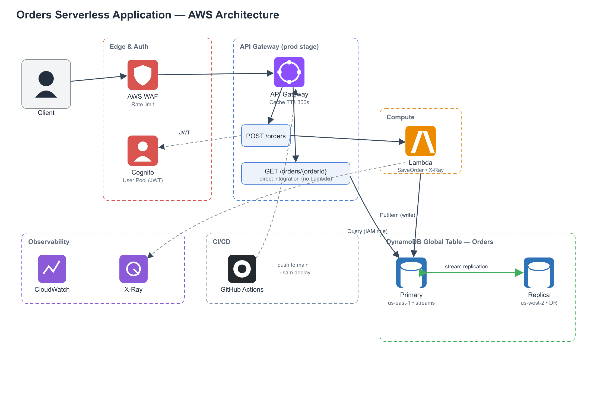
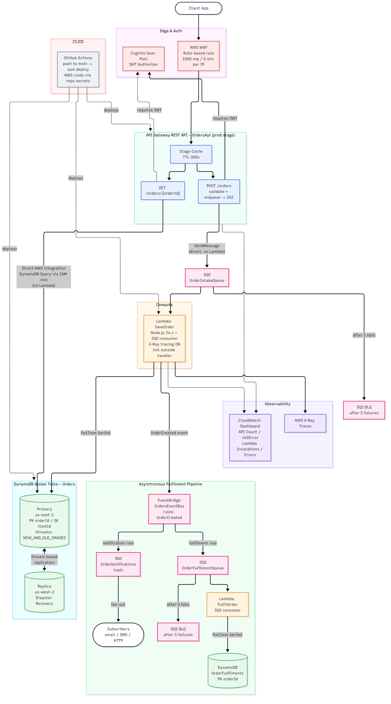
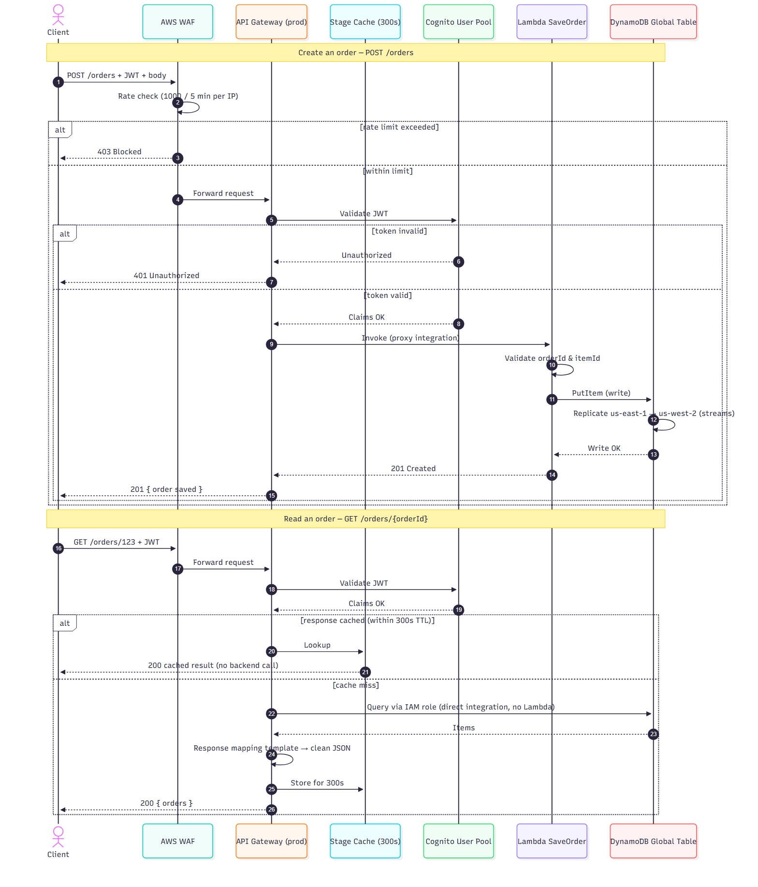

# Orders Serverless Application

A multi-region, serverless order-management backend on AWS, defined entirely as
infrastructure-as-code with AWS SAM and deployed automatically via GitHub Actions.

## Architecture



<details>
<summary>Simplified flow view</summary>



</details>

### Components

| Layer | Resource | Purpose |
|-------|----------|---------|
| Edge | **AWS WAF** | Rate-based rule blocks any IP exceeding 1000 requests per 5-minute window. |
| Auth | **Cognito User Pool** | JWT authorizer; every API method requires a valid token. |
| API | **API Gateway REST API** (`OrdersApi`, `prod` stage) | Public entry point with stage-level caching (300s TTL). |
| Compute | **Lambda `SaveOrder`** (Node.js 24.x) | Validates and writes orders. X-Ray tracing enabled; clients initialized outside the handler. |
| Data | **DynamoDB Global Table** (`Orders`) | `orderId` (PK) + `itemId` (SK), on-demand capacity, streams-based replication to a second region. |
| Observability | **CloudWatch Dashboard** + **X-Ray** | API and Lambda metrics plus distributed traces. |
| CI/CD | **GitHub Actions** | Builds and deploys on every push to `main`. |

## Endpoints

| Method | Path | Integration | Notes |
|--------|------|-------------|-------|
| `POST` | `/orders` | Lambda proxy | Creates an order via the `SaveOrder` function. |
| `GET` | `/orders/{orderId}` | Direct AWS service integration | Queries DynamoDB directly through an IAM role and mapping templates — no Lambda in the path. |

Both endpoints sit behind WAF, require a Cognito JWT, and are fronted by the 300s stage cache.

## Request flow



**Create (`POST /orders`):** WAF rate check → Cognito JWT validation → Lambda
validates the payload → `PutItem` to DynamoDB → write replicates to the secondary
region via streams → `201 Created`.

**Read (`GET /orders/{orderId}`):** WAF → Cognito → if the response is cached
(within the 300s TTL) it returns immediately with no backend call; otherwise
API Gateway queries DynamoDB directly, reshapes the result via a response mapping
template, caches it, and returns `200`.

## Data layer — Global Table

The `Orders` table is a DynamoDB **Global Table** with:

- **Primary region:** `us-east-1`
- **Replica region:** `us-west-2` (disaster recovery / multi-region availability)
- **Streams:** `NEW_AND_OLD_IMAGES` (required for replication)
- **Point-in-time recovery** and **encryption at rest** enabled on both replicas

Writes to either region replicate automatically, so data survives a regional outage.

## Project layout

```
serverless/
├── template.yaml              # SAM template (all AWS resources)
├── samconfig.toml             # SAM deploy settings
├── src/save-order/
│   ├── index.mjs              # Lambda handler
│   └── package.json           # Runtime-only SDK (no bundled deps)
├── .github/workflows/
│   └── deploy.yml             # CI/CD pipeline
└── docs/
    ├── README.md              # This file
    ├── architecture.mmd/.png  # Architecture diagram
    └── request-sequence.mmd/.png  # Sequence diagram
```

## Deployment

Deployment runs automatically on every push to `main` through GitHub Actions,
using AWS credentials stored as repository secrets (`AWS_ACCESS_KEY_ID`,
`AWS_SECRET_ACCESS_KEY`).

To deploy manually from a workstation with the SAM CLI installed:

```bash
sam validate --lint
sam deploy
```

## Regenerating the diagrams

The diagrams are authored in Mermaid (`.mmd`) and rendered to PNG with the
Mermaid CLI:

```bash
npx @mermaid-js/mermaid-cli -i docs/architecture.mmd -o docs/architecture.png -b white --scale 2
npx @mermaid-js/mermaid-cli -i docs/request-sequence.mmd -o docs/request-sequence.png -b white --scale 2
```
